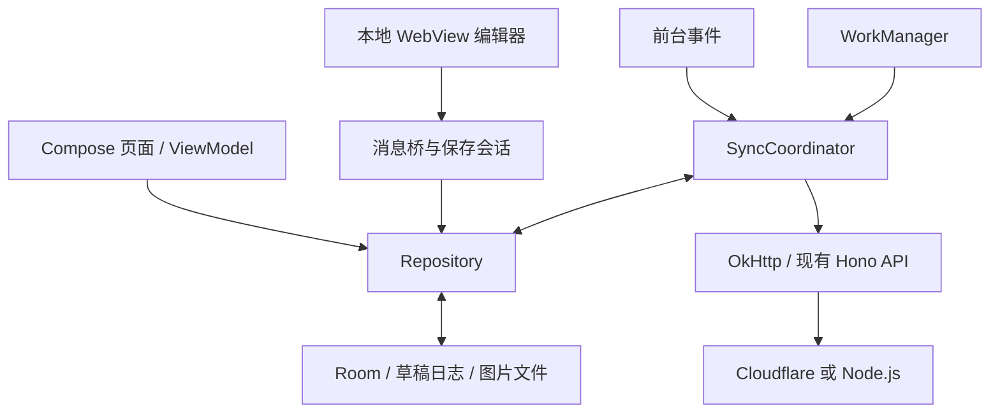

# Android 客户端设计

[返回文档索引](../README.md) · [同步与 API 契约](sync-contract.md) · [开发实施计划](implementation-plan.md)

- 日期：2026-11-19。
- 状态（2026-11-20）：M0–M6 内部交付实现及当前自动验收完成，安装包待人工验收；真机与正式发布门禁保持待验。结果见 [M0](acceptance/2026-11-19-m0.md)、[M1](acceptance/2026-11-19-m1.md)、[M2](acceptance/2026-11-20-m2.md)、[M3](acceptance/2026-11-20-m3.md) 与 [M4–M6](acceptance/2026-11-20-m4-m6.md)，另附 [人工验收清单](acceptance/manual-checklist.md)。
- 方向：优先 Android，使用 Kotlin + Jetpack Compose；第一阶段编辑区域使用本地 WebView + Vditor。
- 应用版本仍以根目录 `package.json` 为唯一来源。本页日期与阶段编号均不是发布版本。

## 1. 产品目标

让 snotes 在 Android 上成为可以快速打开、离线写作、与网页端继续同步的独立客户端。界面、数据库、网络、同步和系统分享由原生代码负责，WebView 只负责 Markdown 编辑与预览。

核心原则：

1. 列表先从本地显示，不等待服务端校验、同步或编辑器初始化；已下载正文只依赖本地读取与必要视图初始化，不等待网络。
2. 内容和待同步任务先持久化，再发送网络请求；清晰区分“已保存到本机”与“已同步”。
3. 与现有网页端使用同一套数据模型和服务端，不另建 Android 专属笔记数据。
4. 冲突、恢复和鉴权失败均保留可恢复内容，不用覆盖、清库或无限重试隐藏问题。
5. 系统能力遵循 Android 生命周期；不承诺后台常驻或实时同步。

### 首个可用版本的范围

| 能力 | 首个可用版本 | 后续阶段 |
| --- | --- | --- |
| 接入服务端 | 配置一个 HTTPS 实例与访问令牌，兼容 Cloudflare / Node.js | 多实例同时使用 |
| 普通笔记 | 列表、新建、编辑、星标、置顶、分组、回收站与恢复 | 批量操作、永久删除和完整统计 |
| 离线 | 已下载正文阅读与编辑、本地自动保存、失败草稿恢复 | 离线插图与附件任务队列 |
| 同步 | 双轨版本、outbox、冲突副本、恢复对账、前台与后台调度 | 推送驱动刷新（需服务端能力） |
| 编辑 | Markdown 源码编辑与预览为兜底；Vditor 即时渲染通过实机验收后开放 | 所见即所得模式的完整移动适配 |
| 图片 | 已有图片显示、离线缓存；联网选择图片并上传 | 相机、离线插图、图片管理 |
| 笔记本 | 同步笔记本与目录，浏览并编辑已有笔记正文 | 新建笔记本、目录编辑、移动、解散与删除 |
| 数据携带 | 单篇 Markdown 导出、分享；失败内容可以另存与导出 | 格式 3 完整备份导入导出 |
| 系统接入 | 后台任务、文件与图片选择器 | 接收系统分享、桌面小组件、快捷入口 |

这里的“首个可用版本”是完成实施计划 M0–M4 后的内部 APK 验收目标，不直接代表稳定发布。未下载正文明确显示状态，不能把正文缺失当成空笔记。

上表保留 M4 的范围划分。M5 已追加笔记本管理、格式 3 备份、系统分享图片队列、小组件与独立打开统计。笔记本引用的结构操作集中在笔记本管理页，并使用持久化 sent 快照、operation_id 重试和独立目录 / 元数据 ACK。普通删除与恢复只对已确认是独立笔记的记录开放；目录归属尚未拉完时也不能猜测。

## 2. 技术决策

| 部分 | 选择 | 原因与边界 |
| --- | --- | --- |
| 语言与界面 | Kotlin、Jetpack Compose、Material 3 | 原生导航、键盘、无障碍与系统接入 |
| 状态 | ViewModel、Coroutines、StateFlow | 页面观察本地数据；同步不依赖页面存活 |
| 本地数据库 | Room / SQLite | 事务覆盖正文、任务、确认与恢复状态 |
| 列表 | Room 查询、Paging 3 | 列表仅加载元数据，避免全部正文进入首屏 |
| 网络 | Retrofit、OkHttp、Kotlin Serialization | 类型化请求、取消、超时和统一错误映射 |
| 依赖注入 | Hilt | UI 与 Worker 共享 Repository / SyncCoordinator |
| 后台 | WorkManager | 可持久化、带网络约束的工作调度 |
| 图片 | OkHttp 私有缓存；WebViewAssetLoader 资源代理 | 当前实现仅原生代理，不引入额外 Coil；缓存限额 128 MiB |
| 设置 | SharedPreferences；独立加密连接文件 | 主题、字号与活跃 profile 为偏好；令牌使用 Keystore，不放入偏好 |
| 凭证 | Android Keystore + AES-GCM | 密钥在 Keystore；加密后的令牌存 app 私有文件 |
| 编辑器 | AndroidX WebKit、WebViewAssetLoader、Vditor | 打包本地资源；API 与持久化留在原生层 |
| 测试 | JUnit、MockWebServer、Room / WorkManager 测试工具、Compose UI Test | 验证事务、真实 API 契约和生命周期 |
| 性能 | Macrobenchmark | 在 release/profileable 构建与真机上测量 |

最低系统配置为 Android 8.0（API 26），低版本实机兼容性仍待后续验收；compileSdk / targetSdk、JDK、AGP、Gradle、Kotlin 和 Compose 已使用 M0 验证通过的配套版本，记录在版本目录与工具链说明中，不使用动态依赖版本。targetSdk 在发布前还须符合分发渠道要求。

第一阶段不引入 Flutter、React Native 或 Kotlin Multiplatform。Web 后端与 Android 的业务协议复用，通过跨语言测试向量保持一致；TypeScript 实现并不直接运行于原生同步层。

### 编辑器方案的决策门

先做可离线运行的编辑器原型，再接完整业务。最少验证中文输入法组合输入、连续输入、选区、撤销、键盘遮挡、旋转、切换笔记和长文。

Vditor 即时渲染模式不通过时，首版使用 Markdown 源码编辑 + 预览。若整个 WebView 输入路径无法满足保存和输入要求，M1 改用 Compose 纯文本编辑 + 本地预览，再继续业务开发；此时先更新本文，不能带着已知丢字问题进入 M4。

M1 当前路线为本地 textarea 源码 + Lute 预览，短文 IR 仅供试用；人工常用中文输入法验收尚未完成，不将 IR 宣称为默认可用模式。原型与资源边界见 [editor-web 说明](../../android/editor-web/README.md)。

## 3. 工程与职责

原生工程已创建于现有仓库 `android/`，启动与构建步骤见 [工程说明](../../android/README.md)。初期只有一个 `:app` Gradle 模块，按包划分职责；性能阶段增加 `:benchmark`。以下目录图包含后续规划，M0 建立 app、model 与 sync 规则，M1 增加 core/editor、feature/editor 与 editor-web。

```text
android/
  app/src/main/java/<application-package>/
    app/                 启动、依赖注入、导航、生命周期
    core/model/          领域模型、版本与状态类型
    core/network/        API、DTO、鉴权、实例边界
    core/database/       Room Entity、DAO、迁移
    core/data/           Repository、事务保存与恢复
    core/sync/           预检、pull、push、checkpoint、调度
    core/security/       令牌加解密与日志脱敏
    core/editor/         WebView 宿主、消息桥、资源代理
    feature/connection/  实例接入与令牌修复
    feature/notes/       列表、阅读与编辑
    feature/notebooks/   笔记本与只读目录
    feature/settings/    偏好、同步状态与数据恢复
    feature/trash/       普通笔记回收站
  app/build/generated/editorAssets/editor/  自动生成的编辑器资源
  editor-web/            独立编辑页面、消息协议与资源构建入口
  gradle/libs.versions.toml
  benchmark/             M6 增加
```

applicationId 已确定为 `io.github.xilele777.snotes`，debug 加 `.debug` 后缀；签名发布后保持固定。它是应用标识，与应用版本不同。



ViewModel 只调用 Repository，不直接拼 HTTP 请求；Worker 不依赖 Activity 或 WebView。编辑器的 `change` 事件不能直接发 PATCH。原生数据库是持久化内容的唯一权威，WebView 不维护第二套 IndexedDB、outbox 或 Service Worker。

## 4. 本地数据设计

一个实例配置对应一个 `profile_id` 和独立数据库、图片目录、草稿目录。首版只允许一个活跃实例；配置迁移必须先停同步、完成保存并隔离旧数据，不能把更换域名当作令牌轮换。

| 表 / 存储 | 关键内容 | 要求 |
| --- | --- | --- |
| `notes` | 服务端元数据、`version`、`prop_version`、`body_version`、dirty | 元数据与正文分表；索引覆盖列表筛选与排序 |
| `bodies` | `note_id`、Markdown 正文 | 行缺失与空字符串区分；本地编辑不自行增加服务端版本 |
| `groups` | ID、名称、顺序、颜色、默认首页可见性、invalid | 有待同步修改时不被旧远端状态覆盖 |
| `outbox` | 自增 ID、实体类型与 ID、kind、payload、seq、retry、next_at、failed、错误 | 实体类型避免分组 ID 与笔记 ID 混链；同实体任务保持因果顺序 |
| `sync_meta` | 两域游标与 checkpoint、当前 / 待接纳 epoch、恢复标记 | 与最终对账提交同事务更新 |
| `history` | note_id、旧正文、时间与来源 | 参考现有历史规则；恢复不覆盖唯一副本 |
| `knowledge_bases` / `tocs` / `note_states` | 笔记本、目录与引用可用性 | 独立于普通笔记版本，首版只读结构 |
| `drafts` | note_id、session_id、revision、原始基线、当前正文、错误 | 恢复时仍检查基线，不能直接覆盖较新的正文 |
| 私有草稿文件 | 与保存会话对应的原子日志 | Room 保存失败时的恢复通道；成功提交后才清理 |
| 图片文件与索引 | profile、file_key、MIME、大小、下载状态 | 已缓存图片离线可读；缓存缺失可补下载 |

保存正文时，在同一 Room 事务内更新正文、派生标题 / 摘要 / 缩略图、历史和 body 任务。星标等属性修改累积已修改字段，不能用默认值重建整条远端记录。删除与恢复任务按最后意图合并，保持与 Web 的最终行为一致。

首版搜索覆盖标题、摘要和本机已下载正文。中文子串搜索不直接依赖 SQLite 默认 FTS 分词；M2 先实现异步、可取消的参数化查询，使用产品样本测量后再决定索引方案。搜索页说明覆盖范围，不把尚未下载正文的笔记解释为没有匹配。

Room 迁移导出 schema 并测试真实旧库升级，不使用 destructive migration。Android 本地 schema 编号、服务端 `migrations/000N_*.sql` 与应用版本是三个不同概念。

M2 当前实现使用 Room 2.8.5 / Paging 3.5.3，首次真实数据库为 schema 1，schema 文件纳入源码。默认活跃 profile 为 `local-default`，私有文件位于 `files/profiles/<profile-id>/`；M1 的样例文件单独保留。列表每页 30 条元数据，中文子串查询绑定参数并取消旧分页。正文事务、属性累积、最终删除意图、receipt 与草稿另存去重的实现及实测边界见 M2 验收记录。后续增加 schema 版本时再补真实旧库升级测试。

## 5. 编辑与保存会话

### 本地资源与消息边界

Vditor 与 Lute 等必要资源从仓库锁定依赖打包，打开笔记不访问公网 CDN。`editor-web/` 不直接复制整个 Vue 工作区，也不假设现有 `VditorEditor.vue` 可以独立运行；提取必要的编辑器适配逻辑，并通过兼容测试保留空行、高亮、表格与图片语义。

使用 WebViewAssetLoader 的受信任本地 HTTPS origin 加载编辑页面。由受 origin 限制的 WebMessageListener 传消息，校验主 frame、消息版本、类型、长度与会话。外部网页不进入带原生消息桥的 WebView；普通链接交给系统浏览器。

| 方向 | 消息 | 最少字段 / 行为 |
| --- | --- | --- |
| Web → Native | `ready` | bridgeVersion、支持的编辑模式 |
| Native → Web | `load` | profileId、noteId、sessionId、原始正文、只读状态、主题、字号 |
| Web → Native | `change` | sessionId、noteId、单调 revision、Markdown、组合输入状态 |
| Native → Web | `flush` | sessionId、requestId；切换 / 返回前读取实时正文 |
| Web → Native | `flushed` | requestId、sessionId、revision、实时 Markdown |
| Native → Web | `saved` / `saveError` | sessionId、已提交 revision 或错误；旧 ACK 不影响新会话 |
| Web → Native | `pickImage` / `openLink` | 会话和经过校验的动作参数，不包含凭证 |

Markdown 通过结构化消息传输，不能拼接成可执行 JavaScript。令牌、任意网络请求、文件读写和数据库接口不暴露给页面。

### 自动保存规则

1. `load` 保留原始 Markdown 基线。编辑器初始化与规范化不算用户改动，不因打开笔记而写回正文。
2. 收到用户 `change` 后由原生层排队记录草稿，再合并正文保存；正文事务初始 debounce 为 800 ms，输入法组合期不强行改写编辑区。
3. 同一笔记保存串行执行。会话基线与当前库不同且双方内容不同，先保留库中正文为冲突副本，再提交输入。
4. 数据库事务成功后才能显示“已保存到本机”，并把原生会话基线推进到此次实际提交的正文，只确认对应 revision；更晚的输入继续处于待保存状态。服务端确认且无更新任务后才能显示“已同步”。两者使用独立状态。
5. 返回、切笔记、切后台和销毁编辑会话前请求 `flush`，读取 Vditor 实时值，不只依赖其延迟 input 回调。主线程不能阻塞等待网络。
6. 远端正文仅在没有未确认输入、待存草稿和 body/create 任务时应用到正在编辑的会话。模式切换与远端刷新不能携带旧文档的撤销历史。
7. 主库事务同时记录会话已提交 revision；重启扫描草稿日志时，已提交的旧日志只清理，不重放，防止提交成功但文件尚未删除时恢复出旧正文。未提交日志按基线检查恢复。保存失败保留原稿、错误和另存 / 导出入口；Room 与文件系统都无法写入时显示失败，不宣称内容已经安全落盘。

强制停止或系统立即杀进程并不保证生命周期回调执行。验收以持久化确认的 revision 为边界，单独测量尚未确认输入的窗口；不能用 `onPause` 或退出前保存推导“绝不丢最后一个字”。

## 6. 页面与交互

| 页面 | 主要行为 |
| --- | --- |
| 实例接入 | 输入服务器 URL 与令牌，显示连接 / 鉴权 / 不兼容的具体状态 |
| 笔记首页 | 本地列表、筛选、搜索、新建按钮、同步摘要；失败不遮住已缓存笔记 |
| 笔记详情 | 本地正文优先、编辑 / 预览、格式工具栏、图片选择、保存与同步状态 |
| 笔记本 | 本地笔记本列表与只读章节树，缺失 / 回收站引用有独立状态 |
| 回收站 | 独立笔记预览与恢复，保留天数来自服务端，不在客户端自行永久清理 |
| 设置 | 主题、字号、服务器、同步状态、失败任务与草稿恢复、单篇导出、版本信息 |

手机以列表 → 详情为主，不强行复刻桌面三栏。导航保留筛选条件、列表位置和笔记阅读位置；系统返回优先关闭图片、菜单与临时面板，再返回上一页。键盘收起与页面返回遵循 Android 行为，不用全局拦截吞掉返回事件。

点击区域至少 48 dp，正文字号使用 sp 并响应系统字体缩放，处理 edge-to-edge、系统栏和 IME insets。深浅色沿用 snotes 品牌语义，低频操作收进菜单。TalkBack、横屏、小屏、字体放大和预测性返回列入真机验收。

保存状态与同步状态可以同时出现，例如“已保存到本机 · 等待联网”。“令牌失效”“部分任务失败”“正在对账”必须可区分；修复令牌前仍允许在既有 profile 中离线阅读与编辑。

## 7. 网络、图片与平台边界

- 首版连接地址为 HTTPS origin，例如 `https://notes.example.com`，不支持路径前缀部署；去掉尾部 `/`，拒绝包含账号密码、query 和 fragment 的地址。API 与正文中的 `/api/images/...` 相对引用统一解析到该实例。
- 所有 API 使用原生 OkHttp。HTTPS 验证不能绕过；明文 HTTP 仅在 debug 构建显式允许本地开发主机，例如模拟器访问宿主机 `10.0.2.2`。
- 令牌只附带给已配置实例的 owner API；跨 origin 重定向拒绝，外链与外部图片不携带令牌。
- WebView 中的私有图片由资源代理读取 app 缓存或以 Bearer 请求服务端，再返回图片数据。正文保留正式 `/api/images/...` 地址，不写入 app 文件路径或临时 URL；不依赖网页端 Cookie。
- 已下载正文不等于图片已缓存。首版提供有边界的图片下载队列与本地缺图状态；空间不足不能删除未同步正文或草稿来腾空间。
- 联网上传使用系统图片选择器，校验实际 MIME 与大小；仅在上传成功且会话仍匹配时插入正式 URL。失败不改动已有文字，离线时不伪装上传成功。
- 令牌与其 Keystore 密钥、数据库、草稿和私有图片默认排除 Android 云备份与设备迁移，显式导出承担数据携带；规则覆盖旧版和新版备份配置，避免恢复密文却没有密钥。
- 笔记正文当前存于 app 沙箱，这不等于数据库加密或端到端加密；与现有产品边界保持一致。日志不输出令牌、完整正文或鉴权请求头。

## 8. 同步调度

`SyncCoordinator` 是所有触发路径的统一入口，单活跃实例只允许一轮同步；前台与 Worker 共享锁和 Room 状态。首版不把 Worker 放入独立进程；取消同步后等待在途请求收尾，不能提前解锁启动重叠上传。

触发来源：应用进入前台、本地改动触发唯一短期任务、网络约束恢复、用户手动同步，以及 WorkManager 周期任务。当前没有前台 30 秒轮询或后台常驻服务；所有入口复用同一协调器。

后台安排具有网络约束的唯一任务，短期上传用 one-time work，周期检查最低按 WorkManager 的 15 分钟规则配置。实际执行可能被 Doze、强制停止和厂商省电延迟，不显示固定“下一次同步时间”。Worker 与应用内退避各有职责：应用记录任务可发送时间，Worker 调度不重复逐条消耗失败请求。

完整协议与事务规则见 [同步与 API 契约](sync-contract.md)。

## 9. 发布与验收边界

开发按 [实施计划](implementation-plan.md) 推进，先关闭输入与同步风险，再增加系统功能。模拟器、JVM 测试、浏览器测试均不能替代 Android 真机验收。

正式发布遵循根目录 [AGENTS.md](../../AGENTS.md)：根包与锁文件同步版本、CHANGELOG、Web / Worker / Server 验证、发布提交、标签、推送、生产部署与 GitHub Release。Android APK / AAB 构建、签名、真机与升级验证是额外门禁，发布记录同时保留 Android 产物校验值与 Cloudflare Deployment/Version ID。

Android `versionName` 从根 `package.json` 生成；`versionCode` 是独立、单调递增的安装排序整数，由受版本控制的构建映射维护，不能用 Git 提交数量或简单 `MAJOR * 10000 + MINOR * 100 + PATCH` 推算预发布顺序。Android 可以连接不同应用版本的后端，是否可用按协议能力判断，不要求两端版本字符串相同。

本次交付不触发正式发布，不创建标签、推送或部署。Android versionCode 从 1 递增到 2，已验证同签名覆盖安装；Room schema 保持 1，无新结构迁移。性能已有模拟器基线，真机预算及系统能力仍按人工清单验收。

## 10. 当前待验证项

| 项目 | 关闭阶段 | 默认决策 |
| --- | --- | --- |
| 目标设备最低系统与 WebView 版本 | M0 / M1 | minSdk 26；以实机编辑器支持结果补充最低 WebView 要求 |
| Vditor 输入与长文表现 | M1 / M6 | 已采用源码 + 预览，短文 IR 试用；人工拼音候选与真机长文性能待验收 |
| 中文正文搜索的规模上限 | M2 / M6 | 参数化子串搜索，测量后决定是否扩展索引 |
| 签名与首个分发渠道 | M6 | 先内部 debug APK；稳定发布前配置签名与产物验证 |
| 完整笔记本编辑与格式 3 备份 | M5 | 实现与自动契约 / 往返验证完成，SAF 系统选择器与日常真实数据待人工验收 |
