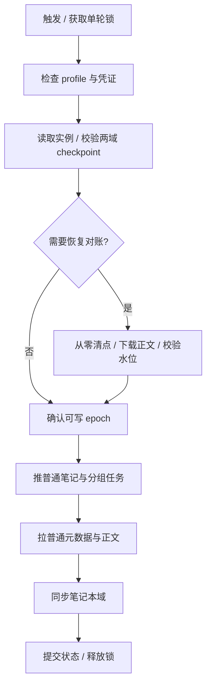

# Android 同步与 API 契约

[客户端设计](README.md) · [实施计划](implementation-plan.md)

日期：2026-11-20。状态：M0 共享规则、M1 编辑器、M2 Room 与 M3 网络同步已实现；M3 自动验收见[记录](acceptance/2026-11-20-m3.md)。本文把现有服务端行为与 Android 新增的客户端约束分开描述，服务端代码与契约测试是最终依据。

## 1. 实现依据

| 范围 | 当前实现 / 测试 |
| --- | --- |
| 数据类型与拉取归并 | [`shared/types.ts`](../../shared/types.ts)、[`shared/sync-reduce.ts`](../../shared/sync-reduce.ts) |
| 待同步任务与退避 | [`shared/outbox.ts`](../../shared/outbox.ts)、[`shared/backoff.ts`](../../shared/backoff.ts) |
| 正文派生与兼容 | [`shared/derive.ts`](../../shared/derive.ts)、[`shared/sanitize.ts`](../../shared/sanitize.ts) |
| 同步 HTTP | [`worker/routes/sync.ts`](../../worker/routes/sync.ts)、[`worker/sync-checkpoint.ts`](../../worker/sync-checkpoint.ts) |
| 写入与鉴权 | [`worker/routes/notes.ts`](../../worker/routes/notes.ts)、[`worker/auth.ts`](../../worker/auth.ts)、[`worker/app.ts`](../../worker/app.ts) |
| Web 同步与本地事务 | [`src/sync/`](../../src/sync/)、[`src/db/repo.ts`](../../src/db/repo.ts)、[`src/db/knowledge-base-repo.ts`](../../src/db/knowledge-base-repo.ts) |
| 笔记本 | [`shared/knowledge-base.ts`](../../shared/knowledge-base.ts)、[`worker/routes/knowledge-bases.ts`](../../worker/routes/knowledge-bases.ts) |
| 两套后端的恢复契约 | [`tests/sync-checkpoint-contract.ts`](../../tests/sync-checkpoint-contract.ts) |
| 两套后端的笔记本契约 | [`tests/knowledge-base-contract.ts`](../../tests/knowledge-base-contract.ts) |

M0 把关键输入 / 输出整理成无凭证的 JSON 测试向量，同一数据同时由 TypeScript 测试和 Kotlin 测试消费。正文派生、合并、版本确认和恢复行为不能各写一套未经对照的解释。

## 2. 连接与认证

- Base URL 为用户配置的 HTTPS origin，不包含路径前缀。每个 profile 的令牌、数据库、缓存与任务隔离。
- owner API 添加 `Authorization: Bearer <token>`。Agent 凭证及 `/api/agent/v1`、`/api/mcp` 不用于客户端登录。
- 同步预检读取 `/api/sync/instance` 的 `epoch`。已完成必要对账后，业务变更请求携带 `X-Snotes-Epoch: <accepted-epoch>`。
- epoch 是恢复围栏，不是应用版本，也不是让客户端自动清空本地数据的新账号标识。
- `/api/health` 仅返回 `{ "ok": true }`，不验证令牌；接入验证必须调用有鉴权的实例接口。
- `/api/runtime` 返回运行形态，不提供应用版本或完整能力清单。初期按必需端点探测兼容性；若将来新增能力接口，需要同步维护服务端契约。
- Web 当前对旧服务端部分 404 做兼容降级。Android 首版要求实例与 checkpoint 接口存在；缺失时报告“服务端暂不支持此客户端”，停止上传，不照搬可能跳过恢复预检的旧版降级路径。
- Kotlin DTO 忽略未知扩展字段，但必需字段、整数范围和正文类型必须校验。`null`、字段缺失、`0` 和空字符串保持各自含义。

## 3. 核心端点

| 方法 | 路径 | 用途 / 关键语义 |
| --- | --- | --- |
| GET | `/api/health` | 无鉴权连通性检查 |
| GET | `/api/runtime` | 有鉴权，识别 Cloudflare / server |
| GET | `/api/sync/instance` | 读取 `{ epoch }` |
| POST | `/api/sync/checkpoint` | 验证 `{ since, checkpoint, require_current? }`，返回 `{ valid }` |
| POST | `/api/sync/pull` | 分页笔记元数据与分组，正文另拉 |
| POST | `/api/sync/bodies` | `{ ids }`，最多 50 个；返回 `{ bodies }` |
| POST | `/api/notes` | 用客户端生成 ID 创建笔记；重试响应检查 `replayed` |
| PATCH | `/api/notes/:id` | 正文和属性变更；显式携带对应基线 |
| POST | `/api/notes/:id/trash` | 普通删除 |
| POST | `/api/notes/:id/recover` | 恢复 |
| POST | `/api/notes/:id/purge` | 永久删除，首版 UI 不开放 |
| POST | `/api/trash/clean` | 永久清空，首版 UI 不开放 |
| GET / POST | `/api/notes/:id/history` | 云端正文历史读取 / 保存；格式见服务端与 shared 类型 |
| POST | `/api/groups` | 创建分组 |
| PATCH / DELETE | `/api/groups/:id` | 修改 / 删除分组，删除行为与 Web 保持一致 |
| POST | `/api/images/upload` | multipart：`file` 与 UUID 形状的 `note_id` |
| GET | `/api/images/:file_key` | Bearer 可用；Web 的 Cookie 例外不作为原生客户端依赖 |
| POST | `/api/knowledge-bases/sync/checkpoint` | 笔记本域 checkpoint 校验 |
| POST | `/api/knowledge-bases/sync/pull` | 笔记本独立时钟与分页 |
| GET | `/api/knowledge-bases/:id/toc` | 笔记本、目录与引用状态 |
| POST | `/api/knowledge-bases` | 后续笔记本创建，使用 `operation_id` |
| PATCH | `/api/knowledge-bases/:id` | 后续元数据变更，使用 `base_meta_version` |
| PUT | `/api/knowledge-bases/:id/toc` | 后续目录写入，使用 `base_toc_version` |
| POST | `/api/knowledge-bases/:id/delete` | 后续永久删除操作；不得用普通删除推断语义 |
| POST | `/api/notes/opens` | 后续打开统计，同步独立于正文与属性 |

### 当前服务端限制

| 内容 | 限制 |
| --- | --- |
| 单篇 Markdown | UTF-8 不超过 1 MiB，不能按 Kotlin 字符数近似 |
| 普通 pull 页 | 默认 200 条，最大 500 条 |
| bodies 请求 | 最多 50 个 ID |
| 图片 | JPEG / PNG / GIF / WebP，文件不超过 10 MiB |
| owner API 请求体 | 全局 12 MiB，具体端点可能有更紧限制 |
| 笔记本目录 | 最多 1,000 节点、8 层、序列化后不超过 1 MiB |
| checkpoint | 当前有效期 7 天，以服务端 `{ valid }` 为准 |

客户端可以采用更小的安全批次，不可以放宽服务端限制。413 时保留本机内容并提示解决办法。

## 4. 版本与状态

| 字段 | 含义 | Android 使用规则 |
| --- | --- | --- |
| `version` | 客户端已确认的服务端正文基线 | body 请求发出时读取，不随本地按键增加 |
| `body_version` | 当前本地缓存正文的服务端基线 | `0` 表示未下载基线；本地新稿也可以是 `0`，结合正文行与 outbox 判断 |
| `prop_version` | 已确认的属性投影基线 | 只由实际确认 / 拉取推进，不能因响应带字段就整体确认 |
| dirty | `none / body / prop / both` | 表示哪条轨道有本地任务，outbox 为待处理依据 |
| `invalid` | `0` 正常、`1` 回收站、`2` 墓碑 | 墓碑处理与回收站恢复是不同操作 |
| `update_time` | 服务端元数据同步水位上的时间 | 不使用设备时间产生同步 since |
| `meta_version / toc_version` | 笔记本元数据 / 目录版本 | 与普通笔记版本不同 |
| `change_seq` | 笔记本时钟 | 不当作 note 的 `server_time` |

所有服务端数值以 Kotlin `Long` 表示并校验 JSON 安全整数范围。时间戳按毫秒保存；UI 日期才转换时区。

### 典型正文写入

```json
{
  "content": "# 标题\n\n正文",
  "title": "标题",
  "summary": "正文",
  "thumbnail": null,
  "base_version": 3
}
```

对应 `PATCH /api/notes/:id`。正文与派生字段属于同一次正文提交；只改星标时提交 `{ "star": 1, "base_prop_version": 2 }`。同时修改两类字段需要两套基线，但首版客户端默认拆成 body / prop 任务，便于确认和重试。

当前 PATCH 的正文冲突并不是常规 HTTP 409：服务端接受本次输入、推进版本，成功响应中带 `conflicted: true` 与 `previous_content`。客户端必须先把被覆盖内容另存冲突副本，再消费任务。属性冲突可标记 conflicted，但不一定包含 previous_content，不能把所有 conflicted 当成正文。

普通笔记 PATCH 没有笔记本那样的 `operation_id` 收据。上传已成功但响应丢失时，重试可能遇到其他设备的新变更，不能宣称网络写入 exactly-once。服务端会保留冲突历史；M3 用丢响应用例核实恢复路径，必要时读取云端历史供恢复。

## 5. 同步轮次与恢复围栏



每个步骤失败都保留 durable 状态；鉴权、恢复围栏或存储失败停止本轮。实际实现需像 Web 引擎一样，在接纳可写 epoch 前完成必须的两域恢复预检。首版笔记本无本地写入，也要保存与校验其独立游标，避免向用户显示错误归属。

以下情况进入恢复对账：已同步 profile 丢失 checkpoint、凭证失效或过期、epoch 变化、服务端水位回退，或 `409 { "error": "sync_reset_required" }`。网络超时不能被当成“预检通过”。

持久化 `reconcile_notes`、`reconcile_books` 与待接纳 epoch。任何必要清点失败或重启后，仍先继续预检 / 对账，再发送旧任务；不得以重启消除恢复状态。

### 普通笔记全量恢复

1. 保存本轮开始时的本地笔记与分组 ID 集合，不能把下载期间新建的记录纳入失踪清理。
2. 以 `since: 0` 分页拉取，记录完整 seen 集合和首个响应的 `server_time / checkpoint`。
3. 已确认墓碑按墓碑规则处理；未确认本地正文不被远端覆盖。有 pending body 时按现有恢复逻辑重置正文发送基线，使服务端保存被恢复覆盖的版本。
4. 下载需要的全部正文；任何缺项 / 异常均不推进最终游标。远端与本地已确认正文不同，按现有恢复逻辑保存本地历史。
5. 结束调用 checkpoint 校验，传首轮水位与 `require_current: true`。失败说明清点期间发生变化，保留现有记录重试，不根据 seen 集合推断失踪。
6. 仅对本轮开始前的记录判断缺失：未确认 create 保留原 ID 与任务；其他有非空正文的缺失笔记先保存恢复副本，再移除旧身份。分组有 pending 修改时保留。
7. 最终清理、恢复副本、游标与 checkpoint 在同一 Room 事务提交，随后完成笔记本域恢复并再次确认 epoch，才能允许上传。

checkpoint 是短期服务端收据，不是跨分页、跨正文、跨笔记本的数据库快照。不能只收到一页就按“服务端没有这个 ID”删除本地笔记。

## 6. 普通 pull

```json
{
  "since": 0,
  "cursor": null,
  "checkpoint": null,
  "limit": 200
}
```

响应包含 `notes`、`groups`、`server_time`、`next_cursor`、`checkpoint` 与可选 `trash_retention_days`。

- 每轮固定 since 与旧 checkpoint，分页 cursor 按返回值原样发送；客户端把 cursor 当不透明字符串，不自行拼接。
- 查询使用 `update_time >= since`，按时间与 ID 排序。重复项正常，Room 使用幂等 upsert，不能因 ID 已存在失败。
- groups 当前只在第一分页返回。其待同步字段不被旧远端状态替换。
- 正文独立批量请求，优先当前打开 / 最近笔记，最大 50 个 ID、初始并发不超过 3。
- 按当前 Web 基线，完成需要的正文下载后才能推进本轮 since；列表可在正文尚未完成时显示已获得元数据。
- 少于请求 ID 数的 bodies 响应不表示那些笔记正文为空：保持未下载状态，终止本轮游标确认。
- 拉正文后的 Room 事务重新检查 pending body / create、草稿和当前版本，请求前的检查不能防止用户在途输入被覆盖。
- 本地 pending purge 不被旧 inventory 复活。首版虽不提供 purge UI，处理已存在的服务端墓碑仍是必需。
- 普通增量结束保存首个响应的水位 / checkpoint，不以最后一页设备时间替代。只有全量恢复才进行失踪推断与 `require_current` 门禁。

打开已缓存笔记先显示本地正文，再用 bodies 点名刷新；有输入 / 草稿 / 待确认任务时不替换。未缓存正文必须等下载成功才能编辑，不能把加载占位当作可保存空正文。

## 7. outbox 与确认事务

### 入队与发送

1. 正文、元数据、dirty 与 outbox 同事务写入；网络请求在事务外执行。
2. 同实体同类修改合并，`seq` 单调增加；新编辑清除该任务旧的 retry、next_at、failed。prop payload 累积修改字段。
3. 同实体任务按顺序串行；不同实体初始最多 3 条并发链。create 未成功、处于退避或失败时，后继操作被阻塞。
4. 发送前重读任务与当前已确认基线；队列快照中已取消 / 被取代的行不能继续发送。
5. Android 持久化发出请求的 task ID、seq、payload 与基线，便于进程退出后解释在途状态。普通笔记的不确定请求仍按其协议重试，不给它伪造 operation_id。

### ACK

在同一 Room 事务中：

- 如果含正文冲突，先保存 previous_content 的冲突副本及其 create 任务。
- 重查当前任务 seq；旧 ACK 不删除更新后的任务，也不把新的输入当成远端已确认内容。
- 可以按实际已接受的正文推进已确认基线，但只有无较新正文任务时才能把当前正文标记为 ACK 版本。
- 不能因 body 响应带 prop_version 就认为整份属性已下载；属性部分写入也不等于确认完整投影。replayed create 不确认此次 payload，后续拉取真实记录。
- 本地版本只按实际接受的轨道推进；dirty 依据剩余任务计算，不能统一设为 none。
- 确认副本与任务消费不能分成可中断的两个事务。响应丢失与重试的重复副本问题通过测试与可追溯来源处理，不假设服务端 exactly-once。

删除 / 恢复互为逆意图，最后一次决定最终状态。普通删除提供与 Web 相同的 5 秒撤销窗口；撤销通过持久化意图反转实现，已经发送也不能只撤回界面。恢复与删除之后始终重新拉取服务端状态。

## 8. 错误处理

| 情况 | 必需行为 |
| --- | --- |
| 无网络、超时、408、5xx | 保留任务，持久化指数退避，停止派发更多失败链 |
| 429 | 保留任务；优先遵循有效 Retry-After / 服务端提示，暂停该 profile 请求 |
| 401 | 停止本轮，标记需要修复令牌；不消费任务、不删除离线内容 |
| 409 + sync_reset_required | 停止所有新上传，保留恢复标记，下一轮先对账 |
| 404 + body 更新 | 保留失败正文任务，提供另存、导出与排错 |
| 其他 404 | 按端点语义区分缺能力与记录缺失；Android 先保留并对账，不能全局解释成删除成功 |
| 410 / 明确墓碑 | 按现有非空正文副本规则保留待确认文字，再原子清理旧身份 / 任务 / 历史 |
| 400、413、415 等不可重试输入错误 | 保留失败任务与内容，展示原因；禁止后台无休止重试 |
| 笔记本 409 / 410 + current | 保存本地快照、阻塞操作，要求冲突处理；不套用普通正文冲突规则 |
| 数据库 / 草稿日志写入失败 | 停同步消费、保留可读内容，明确保存失败；不清库 |

当前普通 outbox 退避基线为 1 秒指数增长、最大 10 分钟。Android 调度可以增加抖动与限流等待，但不得改变持久化与失败内容保留语义。网络恢复只解除暂时退避；永久失败由明确重试或新编辑重新激活。

空 Markdown 是有效值；null / 缺少正文是未获得数据。现有冲突副本仅为非空文字创建，Android 的保存状态与草稿恢复仍必须记录用户清空正文的意图，不能因为 `isBlank()` 就跳过正常保存。

## 9. 笔记本独立协议

### 首版读取

- 元数据使用 `meta_version`，目录使用 `toc_version`；游标使用 `change_seq / until`，独立保存 checkpoint。
- 增量请求带 `since / after / until / checkpoint`。首响应固定 until，后续按 next_after 推进；全量 inventory 使用 `inventory: true` 和 `after_id / next_id`，不能混用两种结束条件。
- 当前每页最多返回 50 个笔记本；逐个读取 `/toc` 获取 book、toc、note_states 与可选 deleted_note_ids，并验证节点合法性。
- 全量读完、目录读完、`require_current` 校验通过后才能提交清点结果。远端中途变化时不得据缺失判断删除。
- note_states 的 available / trash / purged 不等于正文下载完成，UI 分别显示引用状态与缓存状态。
- 目录只读阶段也处理远端笔记本删除、正文墓碑与本地非空未同步内容的恢复，不直接清掉仍可恢复的原稿。

### 后续结构写入

笔记本操作有 `operation_id`、精确基线与已发送请求快照。首次发送后重试必须保持 operation_id 与 payload 完全相同；新本地修改不能重写在途操作。ACK 后再以新 operation_id 发送后续修改。

创建笔记本元数据和目录引用依赖顺序明确：笔记本创建、引用笔记 create 确认完成后，再推目录。冲突保存本地结构快照并阻塞；不能静默最后写入者覆盖目录。需要保留回收站 / 已删除引用时，按服务端 `preserve_missing_references` 与 `archived_meta_version` 契约实现，不能无条件增加这两个字段。

目录编辑、解散、永久删除和跨笔记本移动在实现前增加专项设计与两套后端测试，不属于首版的顺带功能。

## 10. Android 对现有 Web 行为的明确补充

| 决策 | 差异与理由 |
| --- | --- |
| 不兼容旧 checkpoint 端点时停止上传 | 首版不承接 Web 旧客户端历史包袱，避免恢复安全降级 |
| 401 时保留本机离线入口 | 区分同步鉴权与本机内容可用性，不把令牌修复当作数据清理 |
| 非正文 404 先保留再解释 | 当前 Web 某些任务直接消费；原生端优先确认端点与记录语义，避免新端口实现吞操作 |
| 原生图片 Bearer 代理 | WebView 本地 origin 无法直接复用同源 Cookie 读路径 |
| 草稿与主库都参与覆盖检查 | 防止消息桥延迟与输入过程中发生远端刷新 |

这些是 Android 客户端设计，不声称 Web 已实现。若实现时需要服务端变化，先修改共享契约与测试，再安排发布。

## 11. 最低契约验收集

M3 必须覆盖：

1. 离线新建 → 连续编辑 → 联网：create 先于后继任务，所有内容一致。
2. 请求在途再编辑：旧 ACK 不清新任务；旧失败也不把新任务永久失败。
3. 多次属性修改合并：星标、置顶等意图都保留，body ACK 不吞远端属性。
4. 两端同时改正文：成功冲突响应产生可恢复副本，另一端可见。
5. 上传成功但响应丢失、相同 ID create 重试：replayed 不虚假确认内容，云端冲突历史可恢复。
6. 元数据重复分页、正文缺项、部分正文请求失败：幂等入库，最终游标不推进。
7. 拉正文期间输入：草稿、当前会话与 outbox 均不被远端覆盖。
8. checkpoint 过期、水位回退、epoch 改变、相同水位 revision 变化：先对账，后上传。
9. 清点中远端持续写入或 epoch 再次变化：不误删，不接纳不稳定的可写基线。
10. 清点期间本机新建、失踪但未确认 create、失踪但已有正文：分别保留与恢复。
11. 墓碑与 410 遇到本地未确认编辑：副本与旧身份清理原子完成。
12. 401 / 429 / 413 / 存储失败 / 进程退出：内容保留，可解释、可恢复。
13. 只读笔记本目录的分页、引用状态与删除恢复：不混用普通笔记时钟。
14. 前台与 Worker 同时触发：单轮执行，在途请求结束前不解锁。

MockWebServer 验证边界与故障注入；同一客户端还须连接隔离的 Worker 和 Node.js 实例跑真实联通。生产账号与生产数据库不用于契约测试。
