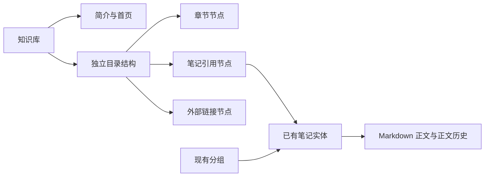

# snotes 知识库设计草案

- 日期：2026-10-14。
- 状态：用户已授权开发，个人知识库 P0 已实施；本文件保留原设计建议，实际接口和升级说明见[知识库使用与实现说明](../../knowledge-bases.md)。
- 代码基线：根目录 `package.json` 的 `version=0.18.0`；当前提交 `55cae1d`。
- 调研依据：[语雀知识库技术逆向报告](../../yuque-knowledge-base-reverse-engineering.md)。
- 已确认范围：个人知识库；用户明确当前不需要权限管理和协作功能。
- 原调研阶段仅交付文档；2026-10-14 用户明确授权开发后实施 P0，随后授权本地提交与部署 v0.19.0，明确不 push。部署结果见[更新记录](../../roadmap.md#更新记录)。

## 1. 目标与推荐方案

为个人笔记增加专题知识库：把散落的笔记组织为有首页、有章节目录、可搜索和阅读的一套内容。继续沿用现有 Markdown 正文、Milkdown 编辑器、离线存储和多设备同步。

推荐采用 **独立知识库 + 独立目录节点 + 引用已有笔记**。笔记仍保留原来的分组，一篇笔记可以加入多个知识库，在任意入口编辑都修改同一份正文。同一个知识库第一版只允许引用某篇笔记一次。

这是对语雀模型的适配：语雀文档响应有一个 `book_id`；本方案为了保留 snotes 的日常分组和信息流，使用目录引用，不把现有分组自动改成知识库。后续开发采用这一推荐，具体行为见使用与实现说明。



## 2. 项目现状与改动边界

以下为代码审阅确认的现状，避免按照旧 README 或旧设计文档假设当前能力：

| 模块 | 当前能力 | 知识库需要补充 |
| --- | --- | --- |
| `shared/types.ts` | NoteMeta、Group、正文/属性版本、Outbox、PullResponse | 知识库元数据、目录聚合版本、任务与响应类型 |
| `src/db/schema.ts` | Dexie v2；notes、groups、outbox、meta、history | 知识库、目录、独立任务队列、目录快照 |
| `src/db/repo.ts` | 笔记读写、列表、正文冲突、软删除与清理 | 引用选择和结构读写，不复制正文 |
| `src/stores/groups.ts` | 扁平分组、颜色、排序、首页可见性 | 保留现有分组语义 |
| `src/sync/pull.ts` | 分页拉笔记、单独拉正文，分组直接 bulkPut | 独立结构版本、防止远端覆盖本地待同步目录 |
| `src/sync/push.ts` | 按任务 kind 与 scope 路由笔记/分组写操作 | 知识库任务的依赖、重放与冲突处理 |
| `src/stores/ui.ts`、`src/navigation.ts` | 列表/编辑器、分组、查询、滚动及返回快照 | 当前知识库、选中节点、首页位置与返回恢复 |
| `src/export/backup.ts` | 格式 1，导出笔记、分组、图片和属性 | 知识库、目录、引用映射及格式兼容 |
| `worker/routes/`、`server/sqlite.ts` | 共用 Hono API、D1/SQLite 存储抽象 | 两种部署都支持同一目录事务语义 |

本方案按个人知识库设计，所有知识库继续使用现有实例级 `ACCESS_TOKEN` 登录与访问。权限管理和协作不纳入当前方案或分期计划：不增加成员邀请、角色、库级 ACL、协作者列表、评论协作或实时共同编辑，也不为这些功能预留表、字段和接口。以后有实际需求时另行设计。

同一用户的多设备同步继续保留。目录版本检查与冲突处理用于保护自己在电脑、手机之间的离线修改，不依赖多人协作功能。

仓库迁移目前到 `0005_home_feed.sql`。未来实施时重新检查最新编号，再追加迁移，不在本次创建或执行 SQL。AGENTS.md 的当前版本文字与 package.json 不一致，本方案按唯一来源 package.json 记基线，不修改该文件。

## 3. 分期范围

| 优先级 | 功能 |
| --- | --- |
| P0：第一版必须完整交付 | 库列表、创建/改名/简介/图标、首页、章节与笔记节点、加入已有笔记、在库内新建笔记、移动排序、库内搜索、离线编辑与同步、结构冲突保留、删除/恢复边界、完整备份 |
| P1：基础稳定后 | 外部链接节点、目录别名、首页指定介绍笔记、跨库批量加入、目录历史浏览与手动恢复、更长目录的虚拟列表、正文大纲 |
| P2：个人整理扩展，另行评估 | BookStack 式集合、发布快照 |

P0 必须保存目录历史及冲突快照；P1 才提供完整的历史浏览和手动恢复界面。P0 的冲突处理仍应有“查看保留的本地目录、重新应用或接受远端”入口，不能只有日志。

不替换编辑器、不实现 Lake 文档格式，不因为语雀有表格/画板/数据表就扩展这些文档类型。

## 4. 页面与交互

### 4.1 导航和知识库列表

现有侧栏增加独立“知识库”入口，进入库列表。分组仍用于日常笔记筛选，知识库用于专题目录，两者同时存在。

列表卡片展示图标、名称、简介、有效笔记数和最近结构/元数据更新时间。库内笔记正文的最近更新时间可以另算，不能把目录版本当正文版本。

创建表单第一版只需名称、图标和简介，不必要求 slug。内部链接使用稳定 UUID，改名不改变地址。

### 4.2 库内工作区

桌面复用现有布局：导航区 → 知识库目录 → 首页或笔记正文。库内不再同时放一列相同笔记列表，避免四栏挤压正文。

首页显示名称、简介、有效笔记数、最近更新和目录入口。目录有“首页”、章节展开、当前节点高亮、搜索、新建与加入笔记入口。

手机按“库列表 → 库首页/目录 → 正文”逐级进入；系统返回恢复目录展开、选中项与滚动位置。320px 下操作菜单收进更多，不横向撑宽。

### 4.3 新建与加入已有笔记

- “加入笔记”：搜索并选择正常笔记，选择章节；已经在当前库中的笔记标记已加入。
- “新建笔记”：调用现有笔记创建路径，再创建引用节点；在章节上下文中新建时放入该章节。
- 新建失败不产生空悬引用；结构同步失败时正文仍在全部笔记中，可以重新加入。
- 在库内加入或新建不自动修改 `group_id` 或 `home_hidden`。是否从首页信息流隐藏，仍使用现有功能，由用户明确设置。

### 4.4 章节、移动和排序

P0 支持章节节点与笔记节点，只有章节可作为父节点；这是为降低复杂度作出的产品约束，与语雀的多种节点模型有差异。

拖动提供“放入章节”和“同级前后排序”的明确落点。手机及键盘提供“移动到…、上移、下移”，不能只靠拖拽。移动章节必须整体移动后代，禁止放进自身或后代。

首次建议最多 8 层、每库 1000 个节点、单次结构载荷 1 MiB；这些是拟定的产品与资源约束，不是语雀限制，也不是性能测试结论。实现前应按 D1 和客户端性能验证并调整。

### 4.5 搜索

库内搜索限定在本库有效笔记引用，复用现有多关键词匹配和摘要高亮，结果显示章节路径。目录标题过滤与全文笔记搜索要有区别。

正文未在本机缓存时，离线结果明确标明“仅搜索已下载内容”；有网络时可请求缺失正文再搜索。P0 不新增独立服务端全文搜索系统，不宣称离线能搜索未下载的正文。

## 5. 建议数据模型

### 5.1 知识库元数据

```text
KnowledgeBase
  id: UUID
  name: string
  description: string
  icon: string | null
  ord: number
  meta_version: number
  toc_version: number              // 服务端已确认的目录版本投影
  invalid: 0 | 1                   // 正常 / 已移除，可恢复
  create_time: number
  update_time: number
```

目录修改应同步推进库的变更时间与目录版本投影，确保其他设备能发现结构变化；元数据版本与目录版本分开，改简介不与移动节点互相冲突。

### 5.2 目录聚合

```text
KnowledgeBaseToc
  knowledge_base_id: UUID
  version: number
  nodes: TocNode[]
  update_time: number

TocNode
  id: UUID
  parent_id: UUID | null
  kind: 'folder' | 'note' | 'link'
  ord: number
  note_id: UUID | null
  title: string | null
  url: string | null
```

- folder：title 必填，note_id 与 url 为空。
- note：note_id 必填；P0 的 title 为空，显示名派生自笔记标题，避免正文改名后目录保留旧标题。
- link：P1 才开放；title 与 url 必填，限制到明确允许的协议。
- 同库节点 id 唯一；同库 note_id 只引用一次；其他库可再次引用。
- ord 仅在同一 parent_id 下有效，重排归一为整数序号，稳定次序使用 `ord + id`。
- 层级由 parent_id 推导，不同时持久化 level 和四种前后连接，减少不一致状态。

推荐 P0 按“每库一份目录聚合”存储和同步，使用父节点 + 排序字段表示节点。借鉴语雀的节点独立身份，不直接复制其链式连接结构。

### 5.3 服务端与本地存储

建议服务端新增 `knowledge_base`、`knowledge_base_toc` 和 `knowledge_base_toc_history`。目录表以 `knowledge_base_id` 为键，保存 version、nodes_json、update_time；nodes_json 是唯一权威结构，树索引为派生结果，不另维护一套可能失步的节点表。

本地新增 knowledgeBases、knowledgeBaseTocs、knowledgeBaseOutbox、knowledgeBaseTocHistory。本地目录记录需要区分服务端确认的 version、待同步的本地 nodes 和 dirty 状态，不用 Date.now 冒充服务端版本。

目录历史保存目录结构，不复制正文。正式表字段和索引需在实施时结合存储抽象细化，本草案不提供可直接运行的迁移。

## 6. 建议接口契约

以下为 snotes 新接口建议，不是语雀接口复用，也尚不存在于项目。

| 接口 | 作用与约束 |
| --- | --- |
| `POST /api/knowledge-bases` | 客户端指定 UUID 创建，重复请求返回已有确认状态 |
| `PATCH /api/knowledge-bases/:id` | 改元数据；带 base_meta_version |
| `GET /api/knowledge-bases/:id/toc` | 返回结构聚合及版本 |
| `PUT /api/knowledge-bases/:id/toc` | 提交完整 nodes；带 base_toc_version 与 operation_id |
| `POST /api/knowledge-bases/:id/remove` | 可恢复移除库；不删除笔记 |
| `POST /api/knowledge-bases/:id/recover` | 恢复库及原目录 |
| `POST /api/knowledge-bases/sync/pull` | 独立分页同步知识库变化 |
| `GET /api/knowledge-bases/:id/toc/history` | P1 的结构历史列表 |
| `POST /api/knowledge-bases/:id/toc/restore` | P1；按历史快照生成新目录版本，不降低版本号 |

目录提交示意：

```json
{
  "base_toc_version": 7,
  "operation_id": "operation-uuid",
  "nodes": [
    { "id": "chapter-uuid", "parent_id": null, "kind": "folder", "ord": 0, "note_id": null, "title": "基础", "url": null },
    { "id": "reference-uuid", "parent_id": "chapter-uuid", "kind": "note", "ord": 0, "note_id": "note-uuid", "title": null, "url": null }
  ]
}
```

服务端验证类型、字段、重复 id、父节点存在、父类型、环、深度、节点数与载荷大小。新增笔记引用必须能解析到已创建笔记；历史里的已删除笔记引用可以保留为占位，不通过结构恢复复活正文。

一次提交中，版本条件检查、保存旧目录快照、保存新目录及推进库变更标记必须原子完成。D1 和 SQLite 两条路径都需验证竞争下的原子性，不能只做“先 SELECT 再无条件 UPDATE”。

## 7. 离线同步与冲突

### 7.1 队列和依赖

使用独立知识库队列，不把库 id 塞进现有 note_id 并让现有正文任务筛选误判。可复用队列的 seq、退避、失败提示与同类任务合并思想。

依赖顺序为：创建库 → 确认笔记创建 → 提交引用目录。批量加入时，所有新引用依赖的笔记创建成功后才提交该目录；没有正文上传完成不等于笔记实体不存在，具体依赖应以服务端确认的笔记 id 为准。

连续目录调整可以合并为最后一份 nodes，但保留原始 base_toc_version。请求在途又发生调整时，seq 增加；旧请求确认不能删除新任务。收到在途成功确认后，应将它确认的目录版本作为下一任务基线，保留较新的本地 nodes，防止产生虚假冲突。

operation_id 在同一次请求重试中保持不变，合并成新请求时生成新 id。服务端保留幂等记录或等价确认信息：响应丢失后重发必须返回同一确认，不能重复增加版本或生成快照。

### 7.2 拉取

知识库同步使用独立游标和分页，不扩充现有笔记分页后让知识库变化随笔记 next_cursor 丢失。新端对不支持接口的旧服务端显示需升级，保留已有笔记功能，不静默声称知识库已同步。

分页以服务端 update_time 加 id 稳定排序，使用边界包含和幂等应用；全部页及所需目录获取成功后才推进游标。首次与必要时执行全量对账，确保移除状态不会让长时间离线设备复活已移除库。

有本地未确认目录时，远端目录不能直接覆盖本地 nodes。可保存远端确认副本，再按下述冲突规则处理。无待同步变更时按目录版本更新本地。

### 7.3 并发目录修改

建议第一版采用乐观并发：base_toc_version 不匹配返回 409，并附当前目录及版本，拒绝静默覆盖。不要对整棵树简单采用最后写入者获胜。

客户端将本地和远端结构分别保存为可辨识快照，暂停该库目录自动重试，并给出：

- 接受远端结构：保留本地快照后应用远端。
- 保留本地结构：展示差异或两份结构，用户选择后以远端最新版本为基线重新提交。

同一库冲突不阻塞其他笔记或知识库同步。第一版不做自动树合并，也不把“结构冲突”错误地变成正文冲突副本。元数据冲突可以同样使用 CAS 和重新确认，不擅自丢失用户输入。

目录快照建议至少覆盖每次已确认的结构变更，并设置有界保留策略；暂拟最近 50 份或 30 天，冲突未处理快照不应被普通清理删除。实际存储预算需评估，数值不是语雀规则。

## 8. 删除、恢复与引用生命周期

| 操作 | 推荐语义 |
| --- | --- |
| 从目录移除笔记 | 只移除当前库的引用，笔记正文和分组保留 |
| 移除章节 | 弹窗明确将移除章节及其中目录引用；不删除被引用笔记 |
| 删除笔记 | 走现有回收站；各库引用显示已删除占位，不误当作空正文 |
| 恢复笔记 | 原引用重新可用；不用重建目录节点 |
| 彻底删除笔记 | 目录保留失效引用占位，用户可清理；不得因拉取不到正文自动创建同 id 笔记 |
| 移除知识库 | 库及结构变为可恢复移除状态，笔记不删除；提供已移除库入口 |
| 恢复目录历史 | 恢复结构，缺失笔记显示占位，不恢复已彻底删除正文 |

区分“正文尚未同步到本机”“笔记在回收站”“笔记已彻底删除”三种状态。正文缺失不能按永久删除展示。

已有 `invalid=2` 笔记墓碑会删除本地笔记副本，因此知识库需要在引用解析层保留已确认失效的状态或查询结果，不能仅凭本地没有笔记判定原因。

P0 不提供知识库永久删除，避免引入新的历史清理与墓碑过期策略。若未来增加，必须定义离线对账与幂等恢复边界。

## 9. 备份与导入

当前 `BACKUP_FORMAT=1`；readIndex 只检查 app 和 notes 数组，没有严格验证 format。不能假设“增加格式号后旧客户端就会主动拒绝”。

建议新完整备份采用格式 2，在 index.json 中增加 knowledge_bases 与目录快照，保留 notes、groups 与原笔记 id。一份正文只导出一次，多个库的目录引用同一 note_id。

导入先建立笔记映射，再导入知识库和节点。笔记、库和节点身份以 id 为主，不按标题合并；库重名允许并提示，避免两套同名但不同结构的库被错误覆盖。

重复导入需要保证笔记不翻倍、引用不翻倍；遇到相同库 id 但不同结构时保留现有结构并报告冲突，不能无提示覆盖。处理过程中断后可重试，导入产生的任务进入正常同步队列。

新端仍能读取格式 1。面向旧端提供显式的格式 1 导出选项，并提示其中不含知识库结构；完整格式 2 导入新版前先校验所有字段和上限。已发布旧端无法事后获得格式拒绝逻辑，需要在升级说明里明确旧端会忽略新增结构的风险。

单条 `.md` 导出保留原能力。若导出 Markdown 文件夹形式的库阅读包，它应与“可完整恢复的备份”区分，不能假设从文件夹层级可以还原跨库共享引用。

## 10. 实施时的模块建议

| 建议模块 | 职责 |
| --- | --- |
| `shared/knowledge-base.ts` | 类型与纯校验、树变换、层级和重复引用约束 |
| `src/db/knowledge-base-repo.ts` | 库/目录本地事务、队列、快照 |
| `src/stores/knowledge-bases.ts` | 库列表及元数据状态 |
| `src/stores/knowledge-base-toc.ts` | 当前目录、选中、搜索及结构动作 |
| `src/components/KnowledgeBaseList.vue` | 库列表与创建入口 |
| `src/components/KnowledgeBaseHome.vue` | 首页与介绍 |
| `src/components/KnowledgeBaseTree.vue` | 树展示，调用领域动作，不承担网络协议 |
| `src/components/AddNotesToKnowledgeBaseDialog.vue` | 笔记选择与重复检测 |
| `src/sync/knowledge-bases.ts` | 独立 pull/push、依赖与冲突 |
| `worker/routes/knowledge-bases.ts` | 鉴权后接口、CAS 与结构校验 |
| `src/export/backup.ts` | 备份格式升级及兼容入口 |

导航快照新增 activeKnowledgeBaseId、activeTocNodeId 和库首页/目录位置；笔记编辑器继续按 note_id 管理撤销栈，跨入口打开同一笔记不能混入另一笔记的撤销历史。

## 11. 验收与未来实施顺序

实施顺序：引用语义 → 领域校验与持久化 → 服务端及离线同步 → 库列表/首页/目录交互 → 删除与冲突入口 → 备份兼容 → 回归验证。个人知识库 P0 已按此顺序实施。

必须覆盖的行为：

1. 现有笔记、分组和首页可见性不因加入库自动改变；同笔记跨库编辑保持同一正文。
2. 目录移动不更改正文版本；章节不能形成环，排序在刷新及换设备后保持。
3. 飞行模式创建库、写笔记、移动章节，联网后按依赖同步。
4. 两设备同时改目录产生 409，保存两份结构，用户可解决，无静默覆盖。
5. 请求成功但响应丢失的重试保持幂等；在途操作后的新修改不会被旧确认清掉。
6. 移除章节或库不删除笔记；笔记删除、恢复、彻底删除后的引用状态正确。
7. 格式 1 导入、格式 2 往返及重复导入正确，正文不重复，缺失引用有提示。
8. Cloudflare D1 与 Node.js SQLite 对相同 API、版本竞争、快照事务表现一致。
9. 1440px、720px、390px、320px 下目录与正文导航、触控移动、返回恢复可用。

未来修改业务代码时运行 `npm run test:all` 和 `npm run build`，补充有意义的结构并发与端到端用例。正式发布按 AGENTS.md 更新 package.json/package-lock、CHANGELOG、提交、标签、推送、部署与 GitHub Release；版本号在实际发布时确定，本草案不提前占用。

## 12. 实施采用的产品选择

个人使用、沿用现有令牌访问、不做权限管理和协作已由用户确认。用户授权开发后，以下推荐已用于个人知识库 P0。

| 选择 | 本草案推荐 |
| --- | --- |
| 知识库与分组的关系 | 独立存在，不自动升级分组 |
| 同一笔记能否加入多个库 | 可以，引用同一份正文 |
| 新增笔记是否自动不上首页 | 不自动隐藏，沿用已有显式设置 |
| P0 是否支持文档节点作为父节点 | 仅章节可作为父节点 |
| 并发结构怎么处理 | 拒绝覆盖、保存双方快照、用户选择后重新提交 |

用户授权按方案开发后，P0 采用上述推荐；后续可根据实际使用反馈调整。
